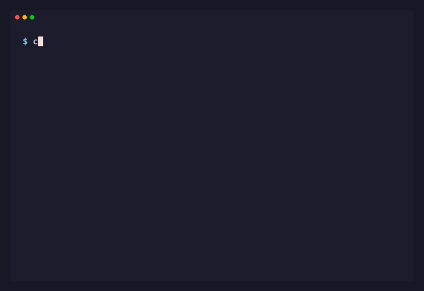
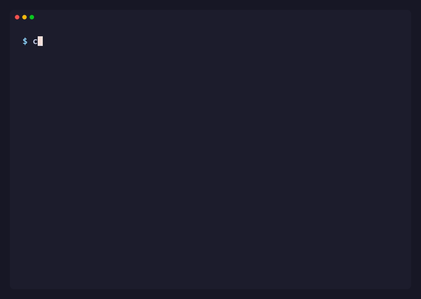

<div align="center">

# Leak Hunter

**A memory leak detector for C in one header.**
Drop it in, compile, run: every block you forgot to free, with its file and line.

[](https://github.com/0xShady/leak-hunter/actions/workflows/ci.yml)
[](https://github.com/0xShady/leak-hunter/releases)
[](https://github.com/0xShady/leak-hunter/stargazers)
[](LICENSE)




</div>

## Contents

- [Why](#why)
- [Features](#features)
- [Quick start](#quick-start)
- [The report](#the-report)
- [What it catches](#what-it-catches)
- [Options](#options)
- [Projects with several files](#projects-with-several-files)
- [Tips](#tips)
- [Reference](#reference)
- [How it works](#how-it-works)
- [Limits](#limits)
- [Upgrading from v1](#upgrading-from-v1)
- [Development](#development)

## Why

A memory leak is memory your program allocates and never gives back. Tools like Valgrind find them, but Valgrind does not run on Apple Silicon Macs, and AddressSanitizer's leak checker is not available with Apple's clang. Leak Hunter needs nothing but a C compiler, so it works the same on macOS and Linux, and it points at the exact line of each leaking allocation, even without debug symbols.

## Features

- 🎯 **File and line** of every block never freed, with its size.
- 🧮 Tracks `malloc`, `calloc`, `realloc` and `strdup`.
- 🚫 Catches **double frees** and frees of pointers that were never allocated, without crashing your program.
- 📄 Report in `leak.log`, in a file you choose, or **straight in the terminal**.
- 📦 **One header**, no install, no dependencies. Builds clean with `-Wall -Wextra -Werror`.
- 🤝 No clashes with your code or libft: only `leak_report` and `print_mem_data` are visible.

## Quick start

**1. Get the header** into your project:

```sh
curl -O https://raw.githubusercontent.com/0xShady/leak-hunter/v2.0.0/leak_hunter.h
```

**2. Include it** in the files you want to track, after the system headers. In **one** `.c` file (the one with `main` is a good choice), define `LEAK_HUNTER_IMPLEMENTATION` first, and register the report:

```c
#define LEAK_HUNTER_IMPLEMENTATION
#include "leak_hunter.h"

char	*greet(const char *name)
{
	char	*msg;

	msg = malloc(strlen(name) + 7);
	strcpy(msg, "hello ");
	strcat(msg, name);
	return (msg);
}

int	main(void)
{
	char	*msg;
	char	*copy;
	int		*numbers;

	atexit(leak_report);
	msg = greet("world");
	copy = strdup("never freed");
	numbers = calloc(4, sizeof(int));
	printf("%s\n", msg);
	free(numbers);
	free(numbers);
	(void)copy;
	return (0);
}
```

**3. Compile and run** as usual, then read `leak.log`:

```sh
cc main.c -o app && ./app
cat leak.log
```

That is the recording at the top: two leaks (line 8 inside `greet`, and the `strdup` on line 22) and one bad free (the second `free(numbers)` on line 26).

## The report

```log
┌─────────┤ LEAKS LOG ├─────────┐
│ Total leaks found:          2 │
│ Total leaks size:          24 │
├───────────────────────────────┤
│ address:          0x104f7d320 │
│ size (bytes):              12 │
│ file:                  main.c │
│ line:                       8 │
├───────────────────────────────┤
│ address:          0x104f7d360 │
│ size (bytes):              12 │
│ file:                  main.c │
│ line:                      22 │
├───────────────────────────────┤
│ Bad frees found:            1 │
├───────────────────────────────┤
│ address:          0x104f7d370 │
│ file:                  main.c │
│ line:                      26 │
└───────────────────────────────┘
```

- **Leaks** come first, in allocation order, with the line where each block was allocated.
- **Bad frees** follow, with the line of the faulty `free`. The section only shows up when there is one.
- A long file path is cut from the left so the file name stays visible: `…c/deeply/nested/util.c`.

When everything is freed:

```log
┌─────────┤ LEAKS LOG ├─────────┐
│ Total leaks found:          0 │
│ Total leaks size:           0 │
├───────────────────────────────┤
│   your code is leaks free!!   │
└───────────────────────────────┘
```

## What it catches

| Problem | In the report |
| --- | --- |
| A block never freed | A leak, with its size and the line that allocated it |
| `free` called twice on the same pointer | A bad free, at the line of the second `free` |
| `free` of a pointer that was never allocated (a stack variable, the middle of a block) | A bad free |
| `realloc` of a pointer that was never allocated | A bad free; `realloc` returns `NULL` |
| A block moved by `realloc` and never freed | A leak with the new size, at the `realloc` line |

Bad frees are never passed to the real `free`, so your program keeps running and the report still gets written. `free(NULL)` is fine and ignored, like the real one.

## Options

Options are compile flags, so you never edit the header.

### Print the report in the terminal



```sh
cc -DLEAK_HUNTER_STDERR main.c -o app && ./app
```

The report goes to stderr and no `leak.log` is created. Handy while iterating, in CI logs, or with testers that read the output.

### Write the report somewhere else

```sh
cc -DOUTPUT_FILE_NAME='"reports/leaks.txt"' main.c -o app
```

The default is `leak.log`, in the directory the program runs from.

### Look before the end

`print_mem_data()` prints the blocks still allocated at that moment, on stdout:

```c
print_mem_data();
```

```log
address: 0x104f7d320
size: 12
file: main.c
line: 8
```

`leak_report()` can also be called by hand at any point, for example at the end of each test.

## Projects with several files

Include `leak_hunter.h` in every file you want to track, usually through your project's main header. Only one `.c` file defines `LEAK_HUNTER_IMPLEMENTATION`:

```c
/* main.c */
#define LEAK_HUNTER_IMPLEMENTATION
#include "leak_hunter.h"

/* utils.c, parser.c, ... */
#include "leak_hunter.h"
```

Prefer to keep it out of your sources? Copy `leak_hunter.c` too (it only holds those two lines) and add it to the build:

```sh
cc main.c utils.c leak_hunter.c -o app
```

Use one way or the other, not both: two implementations end in `duplicate symbol` errors at link time.

## Tips

**Turn it on only when you need it.** Guard the include and the `atexit` behind a flag, and add a Makefile rule:

```c
/* your header, after the system headers */
# ifdef LEAKS
#  include "leak_hunter.h"
# endif
```

```c
/* main.c */
#ifdef LEAKS
# define LEAK_HUNTER_IMPLEMENTATION
#endif
#include "your_header.h"

int	main(void)
{
#ifdef LEAKS
	atexit(leak_report);
#endif
	/* ... */
}
```

```make
leaks: CFLAGS += -DLEAKS -DLEAK_HUNTER_STDERR
leaks: re
```

`make` builds the normal program, `make leaks` rebuilds it with tracking and prints the report in the terminal.

**Read the line, then the call stack in your head.** The line is where the block was allocated, not where it should have been freed. A leak at line 8 inside `greet` means a caller of `greet` kept the result and never freed it.

**Pair it with your tests.** Build your test binary with `-DLEAK_HUNTER_STDERR` and grep for `Total leaks found:          0`.

## Reference

| Name | Kind | What it does |
| --- | --- | --- |
| `leak_report()` | function | Writes the report. Register it with `atexit(leak_report)`, or call it any time. |
| `print_mem_data()` | function | Prints the blocks still allocated on stdout. |
| `LEAK_HUNTER_IMPLEMENTATION` | define, in one `.c` file | Compiles the library into that file. |
| `LEAK_HUNTER_STDERR` | compile flag | Prints the report on stderr; no file is written. |
| `OUTPUT_FILE_NAME` | compile flag | Path of the report file. Default `"leak.log"`. |

Tracked calls: `malloc`, `calloc`, `realloc`, `strdup` and `free`.

## How it works

`leak_hunter.h` defines macros that replace `malloc`, `calloc`, `realloc`, `strdup` and `free` with wrappers that also receive `__FILE__` and `__LINE__`. Each allocation is added to a list with its address, size, file and line; each `free` removes it. When the program exits, `atexit(leak_report)` runs the report, and whatever is still in the list is a leak. A `free` that finds nothing in the list is recorded as a bad free instead of being passed on.

## Limits

- Only files that include `leak_hunter.h` are tracked. Memory allocated by another library and freed in your code shows up as a bad free and is not released.
- It is a debugging tool: each `free` looks the block up in a list. Leave it out of release builds.
- Not thread safe.
- Memory still reachable at exit (a global you never freed on purpose) counts as a leak too.

## Upgrading from v1

v2.0.0 ships as one header. Delete `list_tools.c`, replace `leak_hunter.h` (and `leak_hunter.c` if you keep it), and drop `list_tools.c` from your build line. `t_list`, `xmalloc`, `xfree` and the list helpers are gone, which also ends the clash with libft. Code that only includes the header and calls `atexit(leak_report)` needs no change. See the [release notes](https://github.com/0xShady/leak-hunter/releases/tag/v2.0.0).

## Development

```sh
make test      # builds the tests with -Wall -Wextra -Werror and checks each report
make example   # builds test.c
vhs assets/demo.tape && vhs assets/stderr.tape   # records the gifs again (needs vhs)
```

CI runs the tests on Ubuntu and macOS, plain and with AddressSanitizer and UndefinedBehaviorSanitizer.

## l3aaaz

Big thanks to [mamali](https://profile.intra.42.fr/users/mamali) & [hfadyl](https://profile.intra.42.fr/users/hfadyl) for all the emotional support

## License

[MIT](LICENSE)
